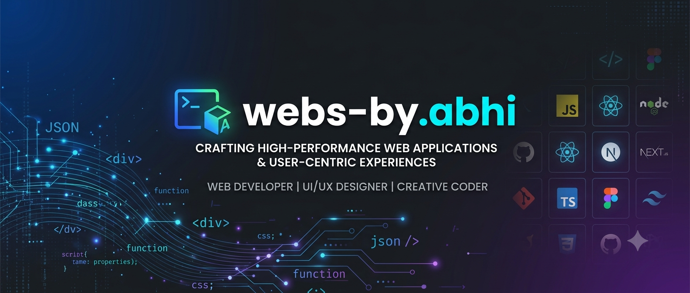

  <!-- 🖼️ CUSTOM BANNER -->
  

    

  <!-- 🚀 HEADER -->
  <h1>👋 Hi, I'm Abhinav Sahu</h1>
  <h3>🎓 BCA AI Student • 💻 Aspiring Full-Stack & AI Developer</h3>

  

    <i>Learning programming, building web projects, and exploring Data Analytics & Artificial Intelligence.</i>
  

  <!-- ⌨️ DYNAMIC TYPING SVG -->
  

    
  

  <!-- 🔘 BADGES & LINKS -->
  

    
    &nbsp;
    
  

---

## 🧑‍💻 About Me

* 🎓 **Education:** BCA in Artificial Intelligence
* 🌱 **Current Focus:** Java, Data Structures & Algorithms (DSA)
* 🌐 **Web Stack:** Full-Stack Web Development Projects
* 🐍 **AI & Data:** Python, Data Analytics & AI Fundamentals
* 🚀 **Goal:** Building impactful, scalable real-world software applications

---

## 🛠️ Languages & Tools

  <!-- Languages -->
  
  
  
  
  
   
  <!-- Frameworks & Tools -->
  
  
  
  

---

## 🎬 Anime & Hobbies

  <!-- Favorite Anime Badges -->
  
  
  
  

<!-- Optional: AniList Stats Widget (Replace YOUR_ANILIST_USERNAME with your username if you use AniList) -->
<!--

  

-->

---

## 📊 GitHub Analytics

  

  

---

  
<i>Designed & Maintained with ❤️ by <b>Abhinav Sahu</b></i>

